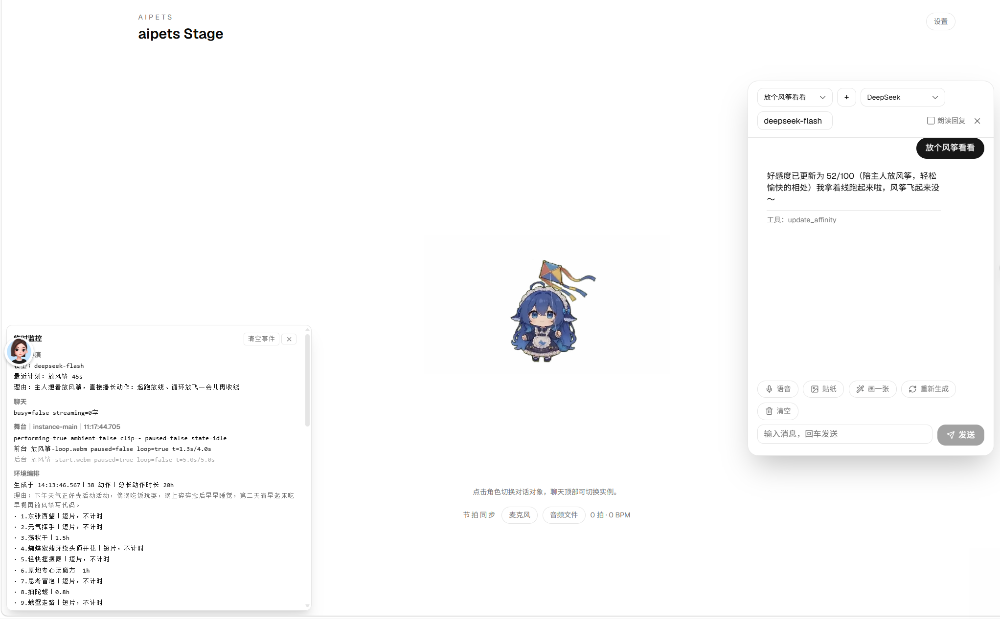
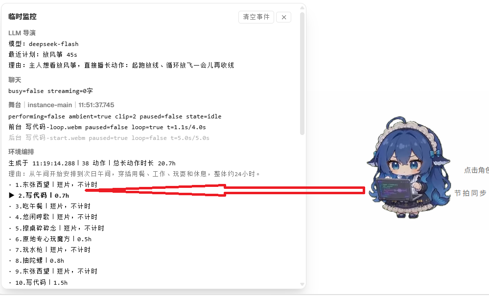
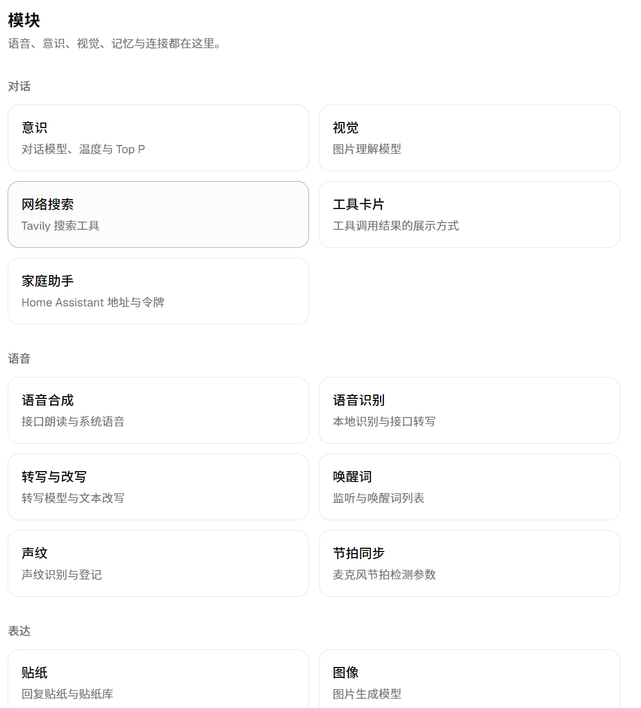

# aipets

Windows 11 桌面宠物。角色站在桌面上，能聊天、会做动作，动作由大模型根据时间、
天气、电量和好感度挑选，不是写死的脚本。

同一套代码有两种形态：**桌面版**（透明置顶桌宠，打包成单个 `aipets.exe`）和
**网页版**（浏览器里的整页舞台，方便预览和调试）。

## 界面预览

### 宠物


### 聊天宠物回应



### 角色行动




### 身体机能



## 功能

### 角色

- 五个角色：蓝毛小女仆、橙毛大小姐、黄毛该溜子、白毛小龙娘、黑毛小狐狸。
- 可同时启用多个实例，每个实例单独缩放、镜像、换角色。
- 待机、说话、思考、被点击、被拖拽五种状态，另有情绪与动作片段。
- 空闲时会自己插入小情绪和长动作（比如坐下哼歌、写代码、玩魔方）。

### 聊天

- 接入任意 OpenAI 兼容接口，支持流式回复。
- 每个角色有自己的性格设定和独立会话。
- 会记住聊过的内容，形成长期记忆；记忆和配方可在设置里查看。
- 可配置工具：联网搜索、Home Assistant、MCP 工具。

### 动作由大模型决定

- 每轮回复后，模型根据上下文挑一组动作播放，例如「开心跃动 → 放风筝」。
- 长时间没人说话，模型会安排一段接近一整天的动作编排，短片穿插、长动作按
  时长保持，放完继续循环。
- 没有配置模型或请求失败时，角色会回退到内置的规则播放，不会僵住。

### 语音

- 可以朗读回复：接口语音或系统语音，接口失败自动退回系统语音。
- 支持语音输入：本地识别、接口转写、用对话模型转写。

### 表达

- 回复可带贴纸。
- 可以让角色画一张图并显示出来。
- 工具调用以卡片形式展示。

### 桌面版专属

- 透明无边框置顶窗口，角色轮廓外点击穿透到桌面。
- 左键拖动角色移动位置，快速甩动会惯性滑动并撞边反弹。
- 托盘菜单、右键菜单、全局快捷键。
- 常驻聊天悬浮球，点击展开聊天窗口。
- 窗口位置和角色大小会被记住。

### 外观

- 浅色、深色、跟随系统三种主题。

## 使用

### 桌面版

双击 `release/aipets.exe` 即可运行，不需要安装。

- **移动角色**：左键拖动。快速甩一下，角色会带着惯性滑一段。
- **和角色聊天**：点右下角悬浮球，聊天窗口会在旁边展开；再点一次收起。
- **右键角色**：打开聊天、设置，或隐藏桌宠。
- **托盘图标**：单击显示/隐藏桌宠；右键有聊天、设置、鼠标穿透、置顶、
  关闭进托盘、重新加载、退出。
- **快捷键**：
  - `Ctrl+Shift+P`：显示 / 隐藏桌宠
  - `Ctrl+Shift+L`：切换鼠标穿透
- **关闭窗口**：默认收进托盘继续运行，只有托盘里的“退出”才真正结束进程。
- **设置**：右键角色或托盘里进入设置。角色大小在「角色卡」里调缩放。

用户配置保存在 `%USERPROFILE%\.aipet`。

### 网页版

打开 `http://127.0.0.1:5173/#/`：

- `#/` 舞台，角色居中，右下角是聊天悬浮球。
- `#/pet` 网页桌宠。
- `#/settings` 设置。

网页版用于预览和调试，没有托盘、窗口穿透等桌面能力。

## 开发者命令

```sh
npm install            # 安装依赖

npm run dev            # 只起网页开发服务器（5173）
npm run dev:electron   # 同时起 Vite 与桌面版窗口

npm run build          # 类型检查 + 前端构建
npm run dist           # 打 Windows 便携版：release/aipets.exe

npm run test           # 单元测试
npm run lint           # 代码检查
```

角色素材在 `assets/characters`，需要重建索引时执行 `npm run characters`。
